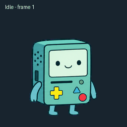
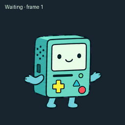
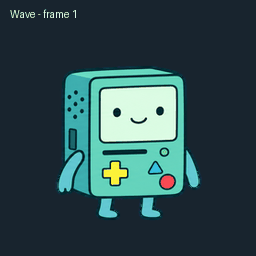

# BMO Desktop Pet

A tiny mint-green pal with a little game on its screen. 🩵

**Pong while ChatGPT is working. Curious eyes that follow the mouse while idle. Quick, natural blinks.** A friendly desktop companion with a full set of playful animations.

## BMO in motion

| Idle | Working — Pong | Waiting |
|:---:|:---:|:---:|
|  |  |  |

| Waving | Jumping | Reviewing |
|:---:|:---:|:---:|
|  |  |  |

| Blocked | Walking right | Walking left |
|:---:|:---:|:---:|
|  |  |  |

| Looking around | Idle and jump |
|:---:|:---:|
|  |  |

## What this project changes

- Loops BMO's six-frame Pong animation for the entire working state.
- Tracks pointer movement while BMO is idle and turns its gaze toward it.
- Makes blinks feel snappier by shortening the eye-closed frames.
- Uses the existing BMO sprite art.

## Install

This is an experimental patch for one specific Linux build of the ChatGPT desktop app.

1. Install the compatible app build and keep its original archive backup.
2. Clone this repository and run `python3 build_patch.py`.
3. Review the generated archive and installer before applying the patch. Installation requires administrator privileges.
4. Start ChatGPT with `bash restart-x11.sh`.

The patch builder checks the exact original archive hash and stops on other versions. ChatGPT updates may replace the patch. On Wayland, the launcher uses XWayland to make global pointer tracking available; behavior can vary by desktop setup. The full application is never distributed here.

## Project notes

The animations above preview the sprite frames. They are not recordings of the live app. The patch has automated checks, but compatibility is limited to the listed app build and has not been verified on every Linux desktop.

Unofficial community project. Not affiliated with or endorsed by OpenAI or Cartoon Network. ChatGPT and BMO belong to their respective owners. See [LICENSE](LICENSE) and [SECURITY](SECURITY.md).
