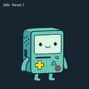
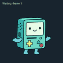
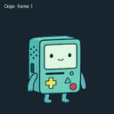
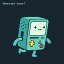
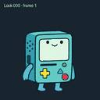
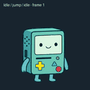

# BMO Desktop Pet

A tiny mint-green pal with a little game on its screen. 🩵

**Pong while work is running. Curious eyes that follow the mouse while idle. Quick, natural blinks.** A friendly desktop companion with a full set of playful animations.

## BMO in motion

| Idle | Working — Pong | Waiting |
|:---:|:---:|:---:|
|  |  |  |

| Waving | Jumping | Reviewing |
|:---:|:---:|:---:|
|  |  |  |

| Blocked | Walking right | Walking left |
|:---:|:---:|:---:|
|  |  |  |

| Looking around | Idle and jump |
|:---:|:---:|
|  |  |

The gallery uses compact, animated previews of the existing sprite frames. 🩵

## What this project changes

- Loops BMO's Pong animation while work is running.
- Tracks pointer movement and turns BMO's gaze while idle.
- Makes blinking snappier with shorter closed-eye frames.
- Preserves the existing BMO sprite artwork.

## Platform support

| Platform | Status |
|---|---|
| Linux (X11) | Patch targets one pinned ChatGPT desktop build. |
| Linux (Wayland) | Experimental; launch through XWayland. Pointer tracking depends on compositor setup. |
| macOS | Not yet ported or tested. |
| Windows | Not yet ported or tested. |

We want to bring this project to macOS and Windows. Each system needs a safe installer and matching app-build checks. Contributions from users with those systems are welcome; include app version and test results.

## Install ChatGPT

These steps install the official ChatGPT desktop app. **They do not install the BMO patch**; the patch currently supports only the pinned Linux build above.

### Windows

1. Open the [official ChatGPT download page](https://chatgpt.com/download/) or the [Microsoft Store listing](https://apps.microsoft.com/detail/9nt1r1c2hh7j).
2. Select **Get/Install** in Microsoft Store and launch ChatGPT from the Start menu.
3. Sign in to your account.

OpenAI lists Windows 10 (x64 or ARM64), version 17763.0 or newer, as the minimum. Its help page currently describes access for paid ChatGPT plans (Plus, Team, Edu, and Enterprise). Check the [Windows app guide](https://help.openai.com/en/articles/9982051-using-the-chatgpt-windows-app) for current details.

### macOS

1. Open the [official ChatGPT download page](https://chatgpt.com/download/).
2. Choose **macOS**, download the installer, and open it.
3. Drag ChatGPT into Applications if prompted, then launch it and sign in.

OpenAI lists macOS 14 or newer and either Apple Silicon (M1 or newer) or Intel as requirements. See the [macOS download guide](https://help.openai.com/en/articles/9275200-downloading-the-chatgpt-macos-app).

## Linux install

This experimental patch targets a specific Linux app archive. It checks the original archive hash and stops if it finds another version. App updates may replace the patch.

1. Install the matching app build and preserve the original archive backup.
2. Clone this repository and run `python3 build_patch.py`.
3. Review the generated archive and installer before applying it. Installation needs administrator privileges.
4. Start the app with `bash restart-x11.sh`.

The animated previews show sprite frames, not recordings of the live app. The full app is never distributed here.

## Disclaimer

Unofficial community project. Not affiliated with or endorsed by OpenAI or Cartoon Network. ChatGPT and BMO belong to their respective owners. Use only with software you are authorized to modify. See [LICENSE](LICENSE).
